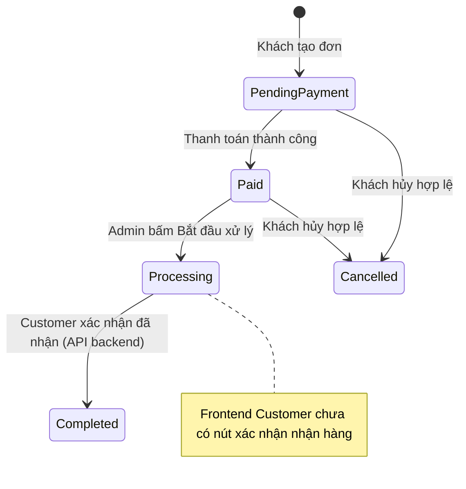

# Luồng Admin chuyển đơn sang Processing

## Mục đích

Tài liệu mô tả phần Admin tiếp nhận đơn đã thanh toán và bắt đầu xử lý đơn tại kho. Phạm vi hiện tại là chuyển trạng thái `Paid → Processing`.

## Luồng nghiệp vụ



1. Khi thanh toán thành công, backend chuyển đơn sang `Paid`, tiêu thụ reservation và trừ tồn kho theo luồng thanh toán hiện có.
2. Admin mở **Xử lý đơn hàng** tại `/admin/orders/processing`.
3. Tab **Chờ xử lý** gọi API danh sách với `status=Paid`; Admin chọn **Bắt đầu xử lý** và xác nhận.
4. Backend khóa bản ghi đơn trong transaction, xác nhận đơn đang `Paid`, đổi trạng thái thành `Processing` và tăng `version`.
5. Frontend tải lại danh sách. Đơn rời tab **Chờ xử lý** và xuất hiện trong tab **Đang xử lý**.
6. Khi đã nhận hàng, Customer có thể gọi API xác nhận `POST /api/orders/:orderId/confirm-received`; backend kiểm tra quyền sở hữu và trạng thái rồi chuyển đơn sang `Completed`.

## Quy tắc tồn kho và hủy đơn

- Bước `Paid → Processing` chỉ cập nhật trạng thái và version của đơn; **không trừ tồn kho lần nữa**.
- Đơn ở trạng thái `Processing` không thể bị khách hàng hủy. Backend chỉ cho phép khách hủy đơn `PendingPayment` hoặc `Paid`.
- Chỉ chủ sở hữu đơn được xác nhận nhận hàng; xác nhận đơn ở trạng thái khác `Processing` bị từ chối.
- Gửi lại xác nhận cho đơn đã `Completed` trả về trạng thái hiện tại mà không cập nhật version thêm.
- Việc chuyển đơn sang `Processing` không tạo thao tác nhập/xuất kho riêng hoặc ghi nhận giao hàng.
- Xác nhận nhận hàng chỉ đổi trạng thái, không thay đổi tồn kho.

## API liên quan

Các endpoint dưới đây nằm dưới `/api/admin/orders` và yêu cầu JWT của người dùng có role `ADMIN`.

### Lấy danh sách đơn

```http
GET /api/admin/orders?status=Paid&page=1&limit=10
GET /api/admin/orders?status=Processing&page=1&limit=10
Authorization: Bearer <admin-token>
```

- Nếu không truyền `status`, backend mặc định lọc `Paid`.
- Chỉ nhận `Paid` hoặc `Processing`; query phân trang được kiểm tra theo validator dùng chung.
- Response có `orders` và `pagination` (`page`, `limit`, `total`, `totalPages`). Mỗi đơn có mã đơn, trạng thái, khách hàng, kho xử lý, tổng số lượng, tổng tiền và thời gian tạo.

### Bắt đầu xử lý

```http
PATCH /api/admin/orders/:orderId/status
Authorization: Bearer <admin-token>
Content-Type: application/json

{"status":"Processing"}
```

- Chỉ chấp nhận target status `Processing`.
- Đơn `Paid` được cập nhật sang `Processing`.
- Gọi lại với đơn đã `Processing` trả về trạng thái hiện tại mà không tăng version thêm.
- Đơn không tồn tại trả `ORDER_NOT_FOUND`; trạng thái khác `Paid`/`Processing` trả `INVALID_ORDER_STATE`.

### Customer xác nhận đã nhận hàng

```http
POST /api/orders/:orderId/confirm-received
Authorization: Bearer <customer-token>
```

- Endpoint chỉ dành cho role `CUSTOMER`; backend lấy customer ID từ JWT, không nhận customer ID từ request body.
- Chỉ chủ sở hữu đơn ở trạng thái `Processing` được chuyển sang `Completed`.
- Đơn không tồn tại hoặc thuộc khách hàng khác trả `ORDER_NOT_FOUND`.
- Xác nhận lặp trên đơn đã `Completed` trả thành công idempotently; trạng thái khác không được xác nhận.

## Vị trí mã nguồn

- Route Admin: `backend/src/modules/order/order.admin.routes.js`
- Truy vấn và định dạng danh sách: `backend/src/modules/order/order.query.service.js`
- Cập nhật trạng thái có khóa transaction: `backend/src/modules/order/order.admin.service.js`
- Customer xác nhận nhận hàng có khóa transaction: `backend/src/modules/order/order.confirm-receipt.service.js`
- Trang Admin: `src/pages/AdminOrderProcessingPage.jsx`
- Khai báo route: `src/App.jsx`
- Mục menu Admin: `src/components/ManagementShell.jsx`
- Hàm gọi API frontend: `src/services/orderApi.js`

## Kiểm thử

Các unit test cho query danh sách, chuyển trạng thái và API client nằm tại:

- `backend/tests/unit/admin-order-list.test.js`
- `backend/tests/unit/admin-order-processing.test.js`
- `backend/tests/unit/admin-order-api-client.test.js`
- `backend/tests/unit/customer-order-confirm-receipt.test.js`

Chạy các test riêng:

```powershell
cd backend
npm.cmd test -- tests/unit/admin-order-processing.test.js tests/unit/admin-order-list.test.js tests/unit/admin-order-api-client.test.js
```

## Phạm vi chưa có

Trang hiện chỉ hỗ trợ Admin chuyển `Paid → Processing` và xem danh sách đơn `Processing`. Backend đã có API để Customer xác nhận `Processing → Completed`, nhưng giao diện Customer chưa có nút thao tác. Theo dõi tiến độ giao/nhận hàng và lịch sử thao tác Admin cũng chưa nằm trong phần triển khai này.
