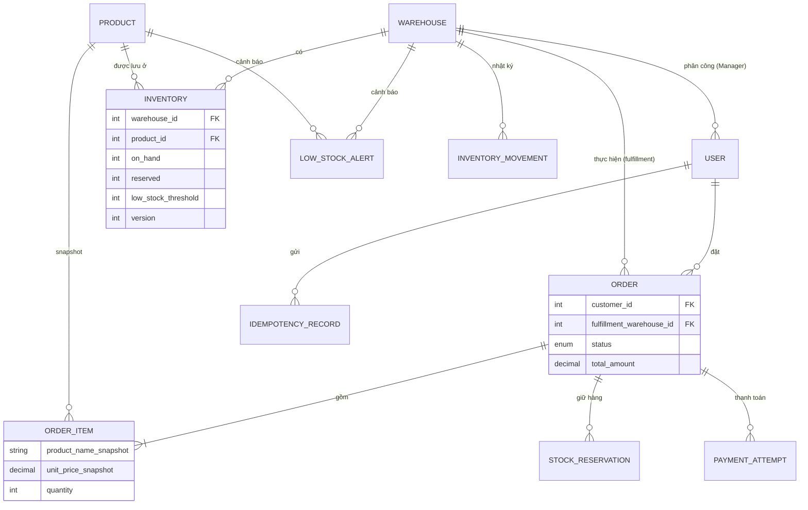

# Thiết kế CSDL – M3 Nguyễn Anh Quân (52400310)

> Phạm vi: lược đồ PostgreSQL/Prisma, bất biến tồn kho, seed và hạ tầng dữ liệu.
> Các mục ghi **[ĐX]** là đề xuất kỹ thuật của M3, cần M2/nhóm xác nhận; không phải yêu cầu nguyên văn của SRS.

## 1. Cài đặt nhanh

```powershell
cd backend
copy .env.example .env
docker compose up -d          # PostgreSQL 16 + Redis 7
npm.cmd install
npm.cmd run db:generate       # sinh Prisma Client
npm.cmd run db:deploy         # áp dụng migration
npm.cmd run db:seed           # 3 kho, 6 tài khoản, 120 sản phẩm, 360 dòng tồn kho
npm.cmd run db:studio         # (tùy chọn) xem dữ liệu
```

Tài khoản demo (mật khẩu `123456` đã hash bằng bcrypt trong DB): `customer`, `customer2`, `warehouse` (kho 1), `warehouse2` (kho 2), `warehouse3` (kho 3), `admin`.

## 2. ERD



## 3. Bảng và truy vết yêu cầu

| Bảng | Mục đích | Truy vết |
|---|---|---|
| `warehouses` | 3 kho | SR-INV-01 |
| `users` | Tài khoản, `role`, `password_hash`, `assigned_warehouse_id` | SR-AUTH-01..05, NFR-SEC-01 |
| `products` | Danh mục; `is_active=false` = ngừng kinh doanh, không xóa | SR-CAT-01..03, SR-PROD-01..03 |
| `inventories` | `on_hand`, `reserved`, ngưỡng theo (kho, sản phẩm), unique cặp | SR-INV-01/02, SR-ALERT-01 |
| `orders` | Đơn, `fulfillment_warehouse_id` duy nhất, trạng thái BR-11 | BR-01, SR-TRACK-01, SR-HIS-01 |
| `order_items` | Snapshot tên/giá | SR-HIS-02, SR-PROD-03 |
| `stock_reservations` | Hàng giữ theo từng dòng đơn (ACTIVE/CONSUMED/RELEASED/EXPIRED) | SR-ORD-03, BR-02/03/04/06 |
| `payment_attempts` | Lần thanh toán giả lập; không có dữ liệu thẻ | SR-PAY-01..04, NFR-SEC-08 |
| `idempotency_records` | Chống gửi lặp/callback lặp theo (user, operation, key) | T19 |
| `low_stock_alerts` | Cảnh báo `available <= threshold`, tối đa 1 OPEN/(kho, sp) | SR-ALERT-02/03, BR-07 |
| `inventory_movements` | Nhật ký biến động tồn kho để đối soát zero-oversell | NFR-REL-01, T08 |

## 4. Bất biến tồn kho (cưỡng chế ở tầng DB)

`available = on_hand - reserved` – **không lưu riêng**.

| Ràng buộc | Tên CHECK/INDEX |
|---|---|
| `on_hand >= 0` | `inventories_on_hand_non_negative` |
| `reserved >= 0` | `inventories_reserved_non_negative` |
| `reserved <= on_hand` (⇔ available ≥ 0) | `inventories_reserved_le_on_hand` |
| `low_stock_threshold >= 0` | `inventories_threshold_non_negative` |
| Giá, số lượng, tổng tiền dương / không âm | `products_price_positive`, `order_items_*`, `orders_total_non_negative`, `stock_reservations_quantity_positive` |
| Manager phải có kho; vai trò khác không có kho | `users_manager_has_warehouse` |
| Tối đa 1 thanh toán PENDING mỗi đơn | `payment_attempts_one_pending_per_order` (partial unique) |
| Tối đa 1 cảnh báo OPEN mỗi (kho, sp) | `low_stock_alerts_one_open_per_item` (partial unique) |
| Tối đa 1 reservation ACTIVE mỗi (đơn, sp) | `stock_reservations_one_active_per_item` (partial unique) |

Nhờ các CHECK này, kể cả khi code có lỗi logic, PostgreSQL sẽ **từ chối** mọi cập nhật gây oversell (BR-12, NFR-PER-05) và transaction bị rollback.

| Sự kiện | on_hand | reserved | Bảng liên quan |
|---|---:|---:|---|
| Reserve q | H | R+q | reservation ACTIVE, movement RESERVE |
| Thanh toán OK | H−q | R−q | reservation CONSUMED, movement CONSUME |
| Thanh toán lỗi / release | H | R−q | reservation RELEASED, movement RELEASE |
| Hủy đơn Paid | H+q | R | movement RESTORE |
| Nhập hàng | H+q | R | movement RESTOCK |

## 5. Quyết định thiết kế [ĐX]

1. **Tiền tệ:** `DECIMAL(15,2)` (VND). Prisma trả về `Decimal` – khi trả JSON dùng `.toString()` hoặc `Number()`.
2. **Enum trạng thái đơn** dùng đúng chuỗi `PendingPayment`, `Paid`... khớp `order.constants.js` của M2.
3. **Seed reserved = 0:** hàng giữ chỉ sinh ra từ đơn thật, tránh `reserved` không có `stock_reservations` tương ứng.
4. **Chọn kho:** dùng `selectFulfillmentWarehouse` của M2 (ưu tiên `warehouseId` nhỏ nhất). M3 cung cấp dữ liệu đã khóa an toàn cho hàm này.
5. **Xóa dữ liệu:** mọi FK dùng `RESTRICT` (trừ `order_items` cascade theo đơn) để không mất lịch sử.
6. **Redis** chỉ là cache đọc (catalog, tổng hợp tồn kho); quyết định reserve luôn đọc PostgreSQL với khóa hàng.

## 6. Điểm cần nhóm chốt

- TTL reservation (`RESERVATION_TTL_MINUTES`, mặc định 15 phút trong `business.js` của M2) và job thu hồi hàng hết hạn.
- Retry thanh toán giữ kho cũ hay chọn lại kho.
- Ai chuyển `Processing`/`Completed`.
